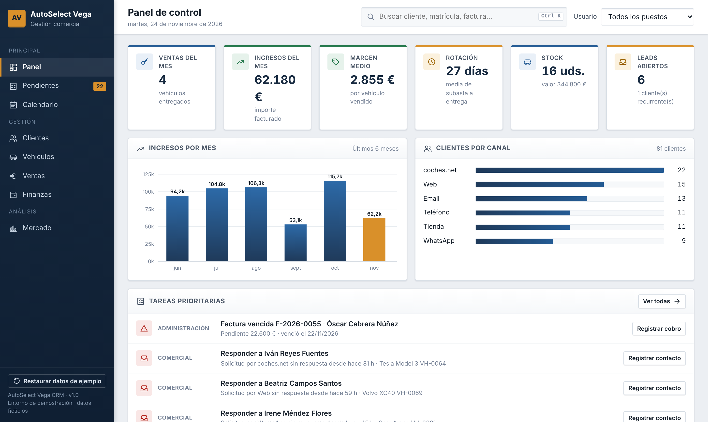

# CRM AutoSelect Vega

CRM web para **AutoSelect Vega**, un compraventa de coches de ocasión con 3 empleados que compra sus vehículos en subastas profesionales (Autorola, Auto1, BCA, Leasys, Ayvens, Arval) y los vende a particulares a través de coches.net, su web y la tienda.

Práctica individual *"Construye el CRM de un pequeño negocio"*: diseñado, construido e iterado con IA (Claude) y publicado en Vercel desde este repositorio.

- **CRM publicado:** https://trabajocrm.vercel.app *(comprobar la URL exacta en el panel de Vercel tras el primer despliegue)*
- **Presentación:** [`entrega/Presentacion_CRM_AutoSelect_Vega.pptx`](entrega/Presentacion_CRM_AutoSelect_Vega.pptx)
- **Mapa de sistemas:** [`docs/mapa-sistemas.png`](docs/mapa-sistemas.png)
- **Cómo se ha usado la IA (qué se pidió, qué falló y cómo se corrigió):** [`docs/proceso-ia.md`](docs/proceso-ia.md)
- **Diseño del CRM:** [`docs/diseno.md`](docs/diseno.md)



## Requisitos de la práctica y dónde se cumplen

| Requisito | Dónde está en el CRM |
|---|---|
| Guardar fichas de cliente y poder buscarlas | **Clientes**: ficha con ID `CLI-0001`, DNI, contacto y canal. Buscador por nombre, DNI, teléfono, email o matrícula, y buscador global (Ctrl+K) |
| Registrar visitas, ventas o contactos de cada cliente | Historial de contactos en cada ficha y operaciones de venta (`OP-0001`) con factura, cobros y documentación |
| Mostrar qué hay que hacer | **Pendientes** (generados solos y repartidos por puesto) y **Calendario** con eventos por persona |
| 2 o 3 indicadores sencillos | **Panel**: ventas e ingresos del mes en €, margen medio, días en stock, leads abiertos. Además, **Finanzas** y **Mercado** |
| Al menos 20 clientes ficticios cargados en el código | 81 clientes, 86 vehículos y 82 operaciones ficticios en [`data.js`](data.js) |

## Funciones

- **Panel**: indicadores, ingresos por mes, clientes por canal, tareas prioritarias y actividad reciente.
- **Pendientes**: tareas generadas automáticamente (leads sin responder, facturas por emitir o vencidas, documentación, entregas, garantías que vencen, coches atascados, pagos a proveedores, eventos de hoy).
- **Calendario**: vista mensual y agenda por persona (Comercial, Compras, Administración), con eventos automáticos y manuales.
- **Clientes**: fichas, historial de contactos, operaciones e historial de cambios. Control de duplicados (DNI, teléfono, email).
- **Vehículos**: stock con número de catálogo `VH-0001`, matrícula y bastidor únicos, coste completo, margen, días en stock y ficha de escaparate imprimible.
- **Ventas**: tablero con fichas que se arrastran (Lead → Reservado → Papeles → Entregado / Perdido) y listado.
- **Finanzas**: facturas y cobros (señal de 300 €, plazo de pago de 3 días, vencidas), gastos (fijos, sueldos, marketing y costes por coche), cuenta de resultados y gráficos de ingresos frente a gastos.
- **Mercado**: qué coches se venden más rápido, cuáles dejan más margen, rentabilidad por marca y modelo, € por día en stock y recomendaciones de compra.
- Exportación a CSV, impresión de facturas, deshacer, menú adaptado a cada puesto y versión móvil.

## Tecnología

- Una página web estática: `index.html` + `styles.css` + `data.js` (datos ficticios) + `app.js` (lógica). Sin librerías externas ni servidor.
- Los datos de ejemplo están en el código, así que cualquiera que abra la URL los ve. Los cambios hechos en la demo se guardan solo en el navegador (`localStorage`) y el botón **Restaurar datos de ejemplo** vuelve al estado inicial.
- Publicación: GitHub → Vercel (plan Hobby). Cada cambio que se sube a `main` se publica solo en la misma URL.

## Cómo abrirlo en local

Basta con abrir `index.html` en el navegador. No hace falta instalar nada.

## Cómo publicarlo en Vercel

1. Entrar en [vercel.com](https://vercel.com) con la cuenta de GitHub.
2. **Add New → Project**, importar el repositorio `TrabajoCRM`.
3. Framework Preset: **Other**. No hace falta comando de build ni directorio de salida.
4. **Deploy**. La URL aparece al terminar.

## Estructura

```
index.html        Página del CRM
styles.css        Estilos
data.js           Datos ficticios (clientes, vehículos, ventas, gastos, eventos)
app.js            Lógica del CRM
docs/
  diseno.md       Diseño: negocio, datos y decisiones
  proceso-ia.md   Cómo se dirigió a la IA: peticiones, fallos y correcciones
  mapa-sistemas.png / .html
  capturas/       Capturas de pantalla para la presentación
entrega/
  Presentacion_CRM_AutoSelect_Vega.pptx
```

> Todos los datos (personas, DNI, teléfonos, matrículas, bastidores, importes) son ficticios. Los documentos imprimibles llevan la marca "documento de demostración, sin validez fiscal".
